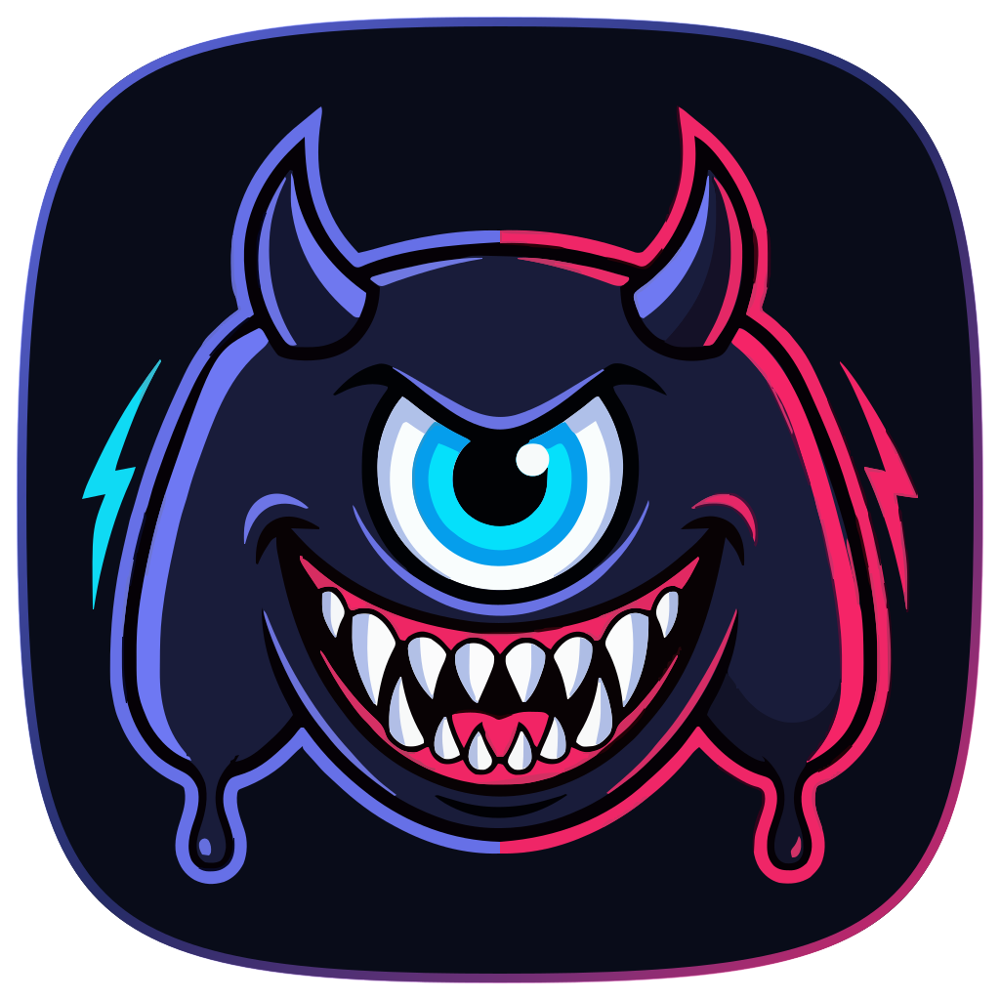

<div align="center">
  
  <h1>FluxCord</h1>
  <p><b>Ультрабыстрый нативный клиент Discord для Windows без Electron и Chromium</b></p>
  <p>
    <a href="https://github.com/So2K/FluxCord/releases/latest"></a>
    
    
    
  </p>
</div>

---

**Стек:** `.NET 10 NativeAOT` + `Win32` + `Direct2D 1.1 (DXGI FlipDiscard)` + C++20 `AVX2` Zero-Copy медиа-движок (`DXGI Desktop Duplication` → `NV12 VRAM` → `NVENC / NVDEC`) + `WASAPI Pro Audio` + официальный `discord/libdave v1.3.0` (MLS E2EE).

## Скачать
Последний портативный билд (`win-x64`, без установки, ~7 МБ):
👉 **[Скачать FluxCord (Latest Release)](https://github.com/So2K/FluxCord/releases/latest)**

Распакуй архив и запусти `FluxCord.exe`. Все последующие обновления прилетят прямо внутрь клиента с **автоматическим возвратом в голосовой канал и открытые стримы**.

## Ключевые цифры (реальные замеры)
- **Память:** ~**75 МБ RAM** в простое (~117 МБ при одновременном просмотре 2 стримов `1080p60 + 1440p30` + исходящем стриме + голосе)
- **Рендер UI:** **0.19 мс** D2D Flush (`0%` CPU в простое)
- **Кодирование стрима (RTX NVENC Zero-Copy):** **0.23 мс** (`1440p / 4K 60–120 FPS`, `H.264 / HEVC / AV1`)
- **Декодирование входящих стримов (NVDEC):** **0.2–0.4 мс**, до **4 стримов одновременно** в сетке + мгновенный фокус на весь экран
- **Портативный релиз:** ~**7 МБ** архив, запуск за `<0.4 сек`

## Возможности
- **⚡ Стрим 2 экранов сразу (Dual-Screen 32:9 Zero-Copy GPU):** аппаратный захват **Монитора 1 + Монитора 2 одновременно** прямо в VRAM через два `IDXGIOutputDuplication` → композитинг на GPU (`ID3D11VideoProcessor`, `3840×1080` или `2560×720`) → `NVENC` (**0.18 мс/кадр**, 0% CPU копирования) прямо в Discord Go Live.
- **Ультра-обновления с возвратом в звонок:** фоновая предзагрузка обновлений с GitHub Releases, проверка SHA-256, атомарная замена за `<1 сек` с откатом при сбое и **автоматический возврат в тот же голосовой канал, с тем же мьютом/деафеном, открытыми стримами друзей (и их громкостью) и запущенной трансляцией экрана**.
- **Голос и шумоподавление Pro Audio:** WASAPI Event-Driven + Opus Stereo 128 кбит/с + адаптивный 20 мс джиттер-буфер + 6 режимов шумоподавления (`Auto Best`, `DeepFilter/MMSE-LSA + KeyKill`, `NVIDIA Broadcast AFX`, `RNNoise`, `Studio DSP`, `Off`) + настройка громкости каждого участника и стрима (`0–200%`).
- **Звук демки без эха:** захват системного/игрового звука через **Windows Process Loopback** (исключает сам процесс FluxCord — друзья слышат игру/браузер, но не эхо своих голосов) с автоматическим fallback на WASAPI Loopback.
- **Турбо-сеть и выбор серверов RTC:** Windows `qWAVE` QoS + `DSCP EF46` (голос) / `AF41` (видео), таймер `1 мс`, `MMCSS Pro Audio / Games`, живой график пинга, параллельный замер регионов RTC и переключение сервера в 1 клик.
- **Полный интерфейс Discord:** вход по QR-коду или токену (шифруется Windows DPAPI), `Ctrl+K` живой поиск, `Ctrl+F` поиск по каналу, список участников, друзья и ЛС, карточки профилей, Drag & Drop + `Ctrl+V` загрузка скриншотов, Lightbox, редактирование сообщений, реакции, эмодзи, закреплённые сообщения, звуки интерфейса и перенос настроек из Dorion/Discord.

## Горячие клавиши
| Комбинация | Действие |
|---|---|
| `Ctrl + K` | Быстрый переход (живой поиск по серверам, каналам и ЛС) |
| `Ctrl + F` | Поиск сообщений в текущем канале |
| `Ctrl + Shift + M` | Вкл/выкл микрофон |
| `Ctrl + Shift + D` | Вкл/выкл звук (Deafen) |
| `Alt + ↑ / ↓` | Предыдущий / следующий текстовый канал |
| `Ctrl + V` | Мгновенная отправка скриншота из буфера обмена |
| `Esc` | Закрыть оверлей / выйти из фокуса стрима |

## Сборка из исходников (Windows x64)
Требуется: Visual Studio 2022/2026 (C++20 + CMake + Ninja) и `.NET 10 SDK`.
```powershell
powershell -NoProfile -ExecutionPolicy Bypass -File .\scripts\release.ps1 -Version 1.0.0 -SkipUpload
```
